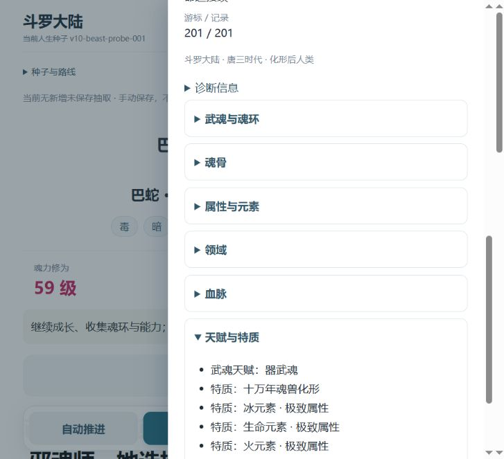

# V1.1.1 Pages 与 Android 验收 — 2026-10-17

[PR #18](https://github.com/MaxwellGuoDUT/douluo-life/pull/18) 合并为 `41b27b508e1f147ed41244455a766b6aebb60a7e`，与候选 `7b178a58c4214881021a77d9a1951b949c765164` Git树相同。合并发生于2026-10-17 00:53:11（Asia/Shanghai）。[Pages](https://github.com/MaxwellGuoDUT/douluo-life/actions/runs/38935413021)及[main CI](https://github.com/MaxwellGuoDUT/douluo-life/actions/runs/38935414147)成功：374项，372通过、0失败、2项来源vault条件跳过。来源检查另见既有本地[复核](v111-pre-release-20261015/REVIEW.md)。

## 部署及桌面检查

112个运行文件，含110个资源的裸URL和带版本URL共222次HTTP响应，全部与已提交候选逐字节一致。见[网络字节](v111-public-20261017/public-bytes.json)、[部署回执](v111-public-20261017/pages-run.json)、[CI](v111-public-20261017/main-ci.json)及[合并回执](v111-public-20261017/merged-pr.json)。没有在线故障注入。

Chromium155公开页面将已有合法201步快照导入空槽3、主动读取并导出，实际下载414,824字节与原文件相同，SHA-256 `741a32457766c7e55581ff434c5a8c3785c2b915805cb1ca5c3e1ff30ceb6d0f`。普通刷新未自动恢复，再主动读取成功；原槽1、2、8及其他原键字节保持。槽2的V1.1.0摘要兼容，不冒充本轮完整读取该槽。见[导出比对](v111-public-20261017/export-comparison.json)及[浏览器记录](v111-public-20261017/browser-validation.json)。

中文元素特质显示正确；390×844和844×390桌面视口无横向溢出。四路线各完成开局并显示转盘，范围止于开局。v10.html实际重定向根入口。桌面窄视口与真机独立记录。

## 用户协助真机

用户针对已部署V1.1.1的复验请求回复“新版均正常”。请求覆盖重新打开页面、中文特质、窄屏转盘/抽屉、键盘/旋转、切后台返回、JSON导出→导入空槽→主动读取及文件选择取消。设备信息沿用Android15 / Chrome大致最新版；机型与精确Chrome版本未提供。本项是用户回报，不冒充代理亲测或iOS实测。

## 保留边界

升级前旧标签页未保留，旧页跨部署续跑未验；iOS未验。201步恢复后的结算显示铜币+800，随后新人生操作遇到浏览器控制超时，该次续跑最终状态未确认，不记为通过，也未证明是产品缺陷。黄级自然旅程仍unresolved；没有追加目标自然搜索。

main CI新增1次已有固定九考回归、131次推进，与此前两次提交CI合计3次/393次推进，单列为提交验证，不改写原自然轮246次启动、53,500调用及超限6次的历史记录。

此公开材料不包含浏览器原始localStorage备份或真实个人存档。捕获原文另保留本地；本目录JSON仅对文本换行及BOM作规范化，截图字节不变，不改写原始捕获文件。
